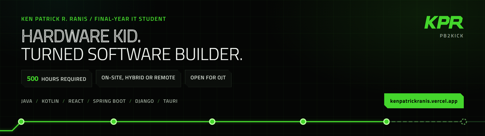

<!-- GitHub profile README for Pb2kick, in the look of kenpatrickranis.vercel.app -->

<table>
<tr>
<td width="62%" valign="top">

### Hardware kid. Turned software builder.

I used to crack open our family PC and dream about building one of my own. Then HTML and CSS pulled me into code, and writing software made me appreciate the hardware even more. This year I finally built my own rig. Now I'm a final-year IT student building web apps, Android apps and desktop software.

>  **Open for OJT / internship:** 500 hours required, on-site, hybrid or remote, based in Cebu, Philippines.

</td>
<td width="38%" align="center" valign="top">

</td>
</tr>
</table>

## My journey

<table>
<tr>
<td width="33%" valign="top">01 / WHERE IT STARTED <b>The family PC</b> Opening up our family computer to see how it all fit together, and dreaming of a build of my own.</td>
<td width="33%" valign="top">02 / FIRST CODE <b>HTML &amp; CSS</b> Simple enough to start, fun enough to keep going. I tinkered until the page looked exactly how I pictured it.</td>
<td width="33%" valign="top">03 / SENIOR HIGH <b>Going past the brief</b> The final project: the best site you could make with HTML and CSS. I added JavaScript on top and scored highest in my section.</td>
</tr>
<tr>
<td valign="top">04 / COLLEGE CAPSTONE <b>Gallus</b> The first time the stakes were real: a real client, expecting a real product.</td>
<td valign="top">05 / 2026 <b>My own rig</b> Saved up and finally built the PC I used to dream about.</td>
<td valign="top">06 / NEXT <b>An internship</b> Learning from a real team and shipping work that people actually use. That's where you come in.</td>
</tr>
</table>

## How I work

- **Make it work.** I'll chase a bug for hours, even days, until it gives. Getting a stubborn feature to finally work is the best feeling in the job.
- **Make it feel good.** Once the hard part works, designing the UI and UX is my reward: the fun part, with nothing left to worry about.
- **Back the lead.** I do my best work as the leader's right hand. I take on the pressure and the details so they can make the hard calls.
- **Own the design.** AI is great at syntax and testing, but it's only as good as its instructions. Knowing what the system should be is my job, so I'm studying system design.

## Tech I've worked with

<table>
<tr>
<td width="24%"><b>Languages</b></td>
<td>

</td>
</tr>
<tr>
<td><b>Frameworks &amp; libraries</b></td>
<td>

</td>
</tr>
<tr>
<td><b>Data &amp; platforms</b></td>
<td>

</td>
</tr>
<tr>
<td><b>Tools</b></td>
<td>

</td>
</tr>
</table>

## Selected projects

<table>
<tr>
<td width="50%" valign="top">

**01 / [Gallus (FeedSmart)](https://github.com/Xeldia/FeedSmart)** 
Capstone · 5-person team

Offline-first records for Philippine layer farmers, with an Android app for staff and a desktop app for the owner. I made the second-most commits and built the first connection between the two apps.

`React` `Capacitor` `Tauri` `Supabase`

</td>
<td width="50%" valign="top">

**02 / [NewsHub](https://github.com/Pb2kick/NewsHub)** 
Full-stack web app

A civic news and election platform with location-aware news, candidate pages and a verified voting flow.

`React` `Spring Boot` `PostgreSQL`

</td>
</tr>
<tr>
<td width="50%" valign="top">

**03 / [FitCampus](https://github.com/Pb2kick/FitCampus)** 
Android app · 2-person team

An offline workout planner that fits training into the free time between a student's classes.

`Kotlin` `Android` `Room`

</td>
<td width="50%" valign="top">

**04 / [AMBOT](https://github.com/Pb2kick/OOP2)** 
Java game · 5-person team

A 2D side-scrolling platformer in Java and Swing that I'm restoring and finishing one world at a time.

`Java` `Swing` `JUnit`

</td>
</tr>
</table>

## Off the clock

**Pb2kick** is my handle since 2014–15: *Plazma Burst 2* plus "Kick", from my old username Kick Buttowski Stunter. I'm a Genji main (the whole look of my site is a love letter to him), I've been hooked on literary fiction since *The Owl House* ended, and my deadlift PR is 225 lb × 3.

My story, my work and two playable projects at <a href="https://kenpatrickranis.vercel.app">kenpatrickranis.vercel.app</a>

